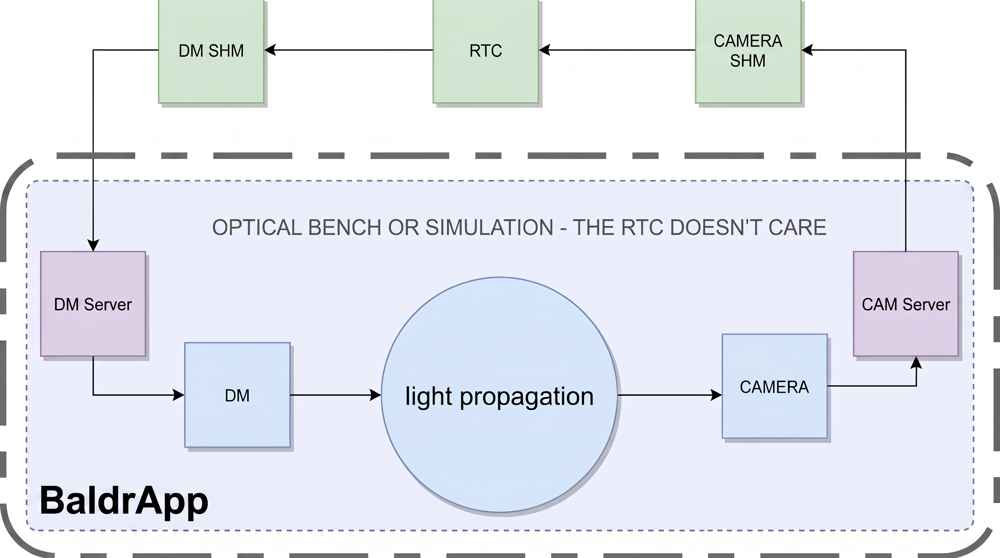

# BaldrApp

Simulating Baldr - the Zernike Wavefront Sensor (ZWFS) for VLTI/Asgard

This repository contains modules and examples for end-to-end testing of a ZWFS. The primary application is a full end-to-end simulator for Baldr, which models optical propagation, the deformable mirror (DM), the camera, and multi-device servers via a ZMQ server-client architecture and shared memory (SHM).
The optical propagation includes polychromatic Fresnel models accounting for a configurable atmosphere, first-stage AO, internal misalignment, and misconjugation.

Because the simulator consumes DM shared memory to update the optical model and produces camera frames to shared memory, it operates transparently to the real-time computer (RTC). Any RTC architecture that reads camera frames and writes to the DM via SHM can be tested seamlessly. 

*Note: Shared memory functionality relies on Linux `/dev/shm` (tested on Ubuntu 20.04 and 24.04).*



## Installation with `pip`
```    
the project can be cloned from the Github:
```bash
git clone https://github.com/courtney-barrer/BaldrApp
cd /path/to/BaldrApp
pip install . -e
```
The pip installation was tested on only on python 3.12.7. To import modules in python for general use:
```
python
import baldrapp
```
To run the paranal simulator after installation simply write in the command line.
```bash
baldr start
```
this should start all the camera, DM and MDS (multi-device server - which controls motors in the real system) as well as a gui to control the Baldr system state, and a gui for the DM control and simulated camera frames of Baldr. For troubleshooting logs will be written to BaldrApp/logs. The PIDs of all these processes are tracked and will continue running in the background even if you close the guis - so to close things properly run 
```bash
baldr stop
```
which will look at the PID log file and close safety all the processes running with the simulator. 

The configuration for the simulator by default is found (and can be updated) here: 
```bash
BaldrApp/src/baldrapp/paranal_simulator/fake_configs/baldr_config.json
```
## Installation with Nix `flake`s
If you are using Nix for package management, you can initialise a `devShell` with all the required dependencies, and installing the python package and GUIs using:
```bash
nix develop
```

This will also give you a shell alias to allow you to start and stop the simulator, e.g.:
```bash
heimbal-sim start  # to start the simulator
```

## Troubleshooting
If you are running this as another user on your linux you might need to give yourself permission to read/write to shared memory which can be done by 
```
sudo chown <user>:<user> /dev/shm/*some_shms* 
```
obviously using your username and whatever shared memory addresses (SHMs) you need to use

## Profiling
Profiling the simulator is now straightforward. Simply run the standard `baldr start` command,
but with the `PROFILE` environment variable set to something truthy:

```bash
PROFILE=1 baldr start
```

This will run for 100 iterations, and then save the profiling results to `profile.out`. Note
that this profile only captures the loop components of the simulation, not the initialisation
or guis. That is, improving this profile will certainly improve the loop-rate of the simulator.